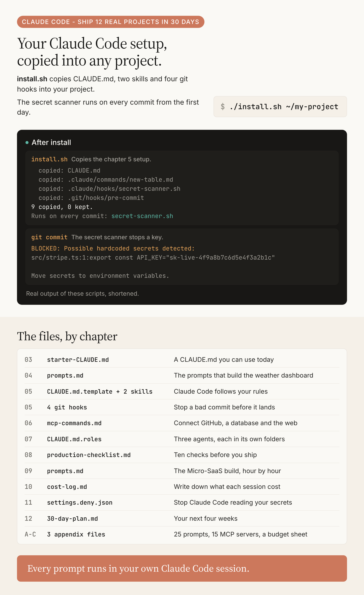

# Claude Code - Ship 12 Real Projects in 30 Days: the companion files

**Copy the book's Claude Code setup into your own project with one command. The prompts are filed by chapter, ready to paste.**

Companion to the book *Claude Code - Ship 12 Real Projects in 30 Days* · [youcanbuildthings.com/books/claude-code-ship-12](https://youcanbuildthings.com/books/claude-code-ship-12)

[](https://github.com/regardo911/claude-code-12-real-projects/actions/workflows/ci.yml) [](LICENSE)

This repo holds the files the book has you write: a CLAUDE.md, two skills (slash commands you type in Claude Code), four git hooks (scripts that run when you commit) and every prompt, filed by chapter. `install.sh` puts the chapter 5 setup into a project you name. Two terms you'll meet first: **CLAUDE.md** is the instructions file Claude Code reads at the start of every session (the chapter 5 folder). An **MCP server** is a connector to GitHub, a database or the web (the chapter 6 folder). A cite like `ch05:399` means chapter 5, line 399 of the book's text; your copy has no line numbers, so read it as "this passage of chapter 5".

## Start here

```bash
git clone https://github.com/regardo911/claude-code-12-real-projects.git
cd claude-code-12-real-projects
```

**I have a project and want the chapter 5 setup in it**

```bash
./install.sh ~/path/to/your-project
cd ~/path/to/your-project && claude
```

`install.sh` copies in CLAUDE.md, the two skills and the hooks, and prints `copied:` or `kept:` for each file. It never overwrites a file you have. The secret scanner runs on your next `git commit` if the project is a git repo with no pre-commit hook of its own; otherwise install.sh prints what to do. Then fill in every `[bracket]` in CLAUDE.md (ch05:399).

**I'm starting from nothing**

```bash
mkdir ~/my-first-claude-project && git init ~/my-first-claude-project
./install.sh ~/my-first-claude-project
cd ~/my-first-claude-project && claude
```

That's the chapter 3 folder (ch03:74). Paste the first prompt from `chapters/03-first-30-minutes/prompts.md`.

**I finished the book and just want the files**

Go to the [copy table](#copy-table).



## Copy table

| Chapter | File in this repo | Where it goes in your project |
|---|---|---|
| 03 | [`starter-CLAUDE.md`](chapters/03-first-30-minutes/starter-CLAUDE.md) | `CLAUDE.md` |
| 05 | [`CLAUDE.md.template`](chapters/05-claude-md-power-system/CLAUDE.md.template) | `CLAUDE.md` (install.sh does this) |
| 05 | [`skills/*.md`](chapters/05-claude-md-power-system/skills) | `.claude/commands/` (install.sh) |
| 05 | [`hooks/*.sh`](chapters/05-claude-md-power-system/hooks) | `.claude/hooks/` (install.sh), and `hooks/pre-commit` to `.git/hooks/pre-commit` |
| 06 | [`mcp-commands.md`](chapters/06-mcp-servers/mcp-commands.md) | your terminal, one command per server |
| 07 | [`CLAUDE.md.roles`](chapters/07-multi-agent/CLAUDE.md.roles) | append to `CLAUDE.md` |
| 08 | [`ci.yml`](chapters/08-production/ci.yml) | `.github/workflows/ci.yml` |
| 08 | [`env.example`](chapters/08-production/env.example) | `.env.example` |
| 08 | [`production-checklist.md`](chapters/08-production/production-checklist.md) | append to `CLAUDE.md` |
| 10 | [`gitignore.example`](chapters/10-cost-control/gitignore.example) | merge into `.gitignore` |
| 11 | [`settings.deny.json`](chapters/11-safety/settings.deny.json) | merge into `.claude/settings.json` |
| 11 | [`CLAUDE.md.safety-rules`](chapters/11-safety/CLAUDE.md.safety-rules) | append to `CLAUDE.md` |
| A-C | [`appendices/`](appendices) | keep open beside Claude Code |

## Chapter map

| Chapter | What you build | The file or command | You pass when |
|---|---|---|---|
| 01-02 | Nothing yet | No files; read them | You can sort the ch02 gut-check tasks between Chat, Code, the API and Cursor |
| [03](chapters/03-first-30-minutes) | Your first CLAUDE.md and a worklog tool | `prompts.md`, `practice-CLAUDE.md` | Claude Code follows your CLAUDE.md rules and its tests pass |
| [04](chapters/04-app-before-lunch) | A live-data dashboard at a public URL | `prompts.md` | You text the URL to someone and they see working data |
| [05](chapters/05-claude-md-power-system) | Your CLAUDE.md, skills and hooks | `./install.sh <your-project>` | A commit with a hardcoded key is rejected; `/new-table` runs its steps |
| [06](chapters/06-mcp-servers) | GitHub, a database and fetch, in one prompt | `mcp-commands.md`, `prompts.md` | Data flows between all three with no copy-paste from you |
| [07](chapters/07-multi-agent) | A Researcher, a Builder and a Reviewer | `prompts.md`, `CLAUDE.md.roles` | The Reviewer's tests pass and the CLI answers from the live OSV API |
| [08](chapters/08-production) | Your chapter 4 app with tests, CI and a deploy | `prompts.md`, `production-checklist.md` | All ten checklist items are green and the app is live |
| [09](chapters/09-micro-saas) | A Micro-SaaS with sign-up, Stripe and SMS | `prompts.md` | It takes a test payment and sends a reminder at your own URL |
| [10](chapters/10-cost-control) | A cost log and a context habit | `cost-log.md`, `context-cheatsheet.md` | You predict a task's cost before you start it |
| [11](chapters/11-safety) | Deny rules, safety rules, a checklist | `settings.deny.json` | Claude Code refuses to read your `.env` |
| [12](chapters/12-roadmap/30-day-plan.md) | Your next 30 days | `30-day-plan.md` | Every blank is filled and the first project is picked |
| [A-C](appendices) | 25 prompts, 15 MCP servers, a budget sheet | `appendices/` | |

## How it fits together

The chapter 5 system is the product, not the code Claude Code writes (ch05:381). It's five kinds of file, each run at a different moment:


`install.sh` puts three of them in place: CLAUDE.md, the skills and the pre-commit runner. `~/.claude/settings.json` and the PostToolUse hook are yours to write (ch05:25, ch05:277).

## What it needs

The prompts and skills run in your own Claude Code session, on a Pro plan or better (ch03:9). Paste one in and Claude Code writes the files in your project.

`install.sh` and the secret scanner need only bash and git. No key, no network, so you can set a project up before you open Claude Code.

The other three hooks are for a Node project (Node 18+). The coverage gate and the tsc/eslint/vitest gate run your project's own tools. The bundle-size guardian looks each new package up on bundlephobia.com, with curl and bc.

`bash tests/run.sh` runs offline. It uses node for the Node-hook tests and counts them as skipped without it.

Fixes to the book's own files, each with the command that proves it, are in [BOOK-FIXES.md](BOOK-FIXES.md).

## Before you give Claude Code a broad task

Do the chapter 11 setup first. [`settings.deny.json`](chapters/11-safety/settings.deny.json) blocks reads of `.env`, keys and `~/.ssh`. [`CLAUDE.md.safety-rules`](chapters/11-safety/CLAUDE.md.safety-rules) tells Claude Code to list what it would delete and wait for your yes. [`preflight-checklist.md`](chapters/11-safety/preflight-checklist.md) is four questions to answer before each session. Commit before every session. Don't type "clean up the project" into Claude Code: ch11:19 explains why.

## Contributing

Fixes are welcome. Each book file opens by naming its chapter and lines, so you can match it to the page. See [CONTRIBUTING.md](CONTRIBUTING.md).

## License

MIT, see [LICENSE](LICENSE). Educational software from a book, provided as-is, with no warranty.
